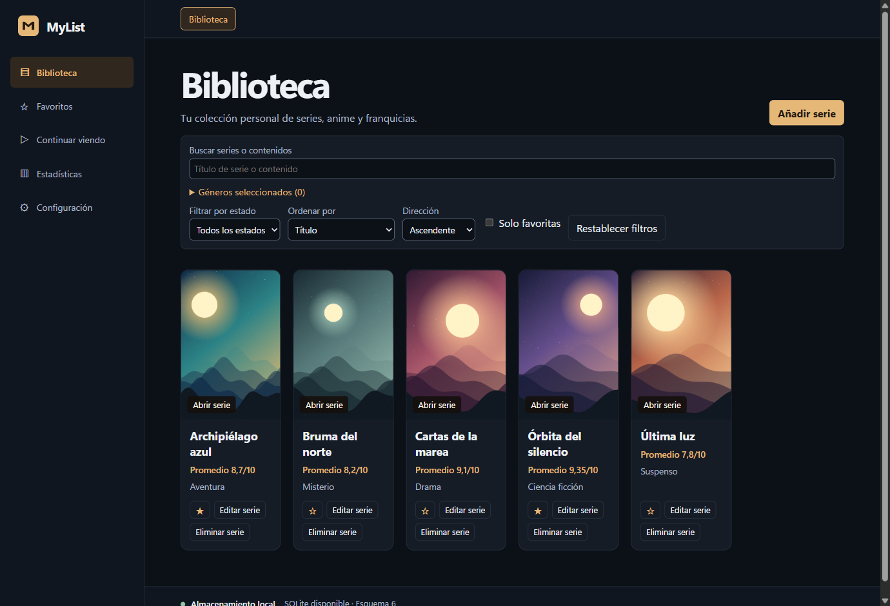

# MyList

**Tu biblioteca personal de series, anime y franquicias para Windows.** Organiza tu colección con portadas, marca favoritas y retoma lo que estás viendo. Tu catálogo se guarda en tu equipo y MyList funciona sin conexión y sin cuenta.

[**Descargar MyList 1.0.0 para Windows (64 bits)**](https://github.com/daniel1058a/MyList/releases/tag/v1.0.0)

- Busca por título, combina filtros por género y estado, y ordena tu catálogo por calificación.
- Registra episodios, notas, opiniones y revisualizaciones. Consulta tu avance en **Continuar viendo** y **Estadísticas**.
- Personaliza el tema, el tamaño de las portadas y el idioma. Guarda un respaldo ZIP o exporta el catálogo a CSV y Markdown.

## Capturas



Más vistas del catálogo de demostración. [Detalle de una temporada](docs/capturas/detalle.png) · [Estadísticas en tema claro](docs/capturas/estadisticas.png)

## Instalar MyList 1.0.0 en Windows

1. Abre la [página de la versión 1.0.0](https://github.com/daniel1058a/MyList/releases/tag/v1.0.0). Descarga `MyList_1.0.0_x64-setup.exe` de la sección de archivos y ábrelo. El asistente instala MyList para tu cuenta de Windows.
2. Abre **MyList** desde el escritorio o el menú Inicio. La instalación incluye el runtime WebView2 Evergreen para equipos que lo necesitan. MyList funciona con archivos locales y se ejecuta sin Node.js ni Rust. [Instalación sin conexión de WebView2](https://developer.microsoft.com/en-us/microsoft-edge/webview2/)
3. Para desinstalar, busca **MyList** en **Configuración de Windows → Aplicaciones**. Deja desmarcada la opción de eliminar datos de la aplicación para conservar tu biblioteca.

El instalador de esta entrega está sin firma digital. Windows puede indicar que el editor es desconocido, mostrar una advertencia de SmartScreen o bloquear la instalación según la política del equipo. [Reputación de aplicaciones de Windows](https://learn.microsoft.com/windows/apps/package-and-deploy/smartscreen-reputation)

SHA-256 del instalador entregado.

```text
829257C7232046E8E7C2A30B41E681334CC323F2A67A6AA6A5D397FF6010ECFE
```

### Pasar el catálogo de desarrollo a la versión instalada

1. En tu MyList actual, abre **Configuración → Respaldos y exportaciones → Guardar respaldo ZIP**. Guárdalo en una carpeta de tu elección y cierra MyList.
2. Instala la versión 1.0.0 con la misma cuenta de Windows. Al abrirla, debe aparecer tu catálogo. El instalador y el ejecutable de desarrollo usan el identificador `com.mylist.desktop` y guardan los datos en `%APPDATA%\com.mylist.desktop`.
3. Si cambias de cuenta o de equipo, o si el catálogo no aparece, abre **Restaurar desde ZIP**, selecciona el respaldo y revisa sus recuentos antes de confirmar. El ZIP conserva las imágenes, las relaciones, las sesiones y las preferencias. La restauración guarda primero una copia preventiva del catálogo de destino.

## Requisitos de desarrollo en Windows

- Node.js 22.13 o posterior de la serie 22, o Node.js 24 o posterior, con npm.
- Rust estable mediante rustup, con el destino MSVC correspondiente al equipo. Para Windows x64, ejecuta `rustup default stable-x86_64-pc-windows-msvc` después de [instalar Rust](https://www.rust-lang.org/tools/install).
- Visual Studio Build Tools con la carga **Desarrollo para el escritorio con C++**, MSVC y un SDK de Windows. Instala WebView2 Evergreen si el runtime no está presente. [Prerrequisitos de Tauri](https://v2.tauri.app/start/prerequisites/#windows)

Si acabas de instalar las herramientas, abre una nueva terminal antes de verificar el entorno. En PowerShell se usa `npm.cmd` para ejecutar npm con la política de scripts vigente.

## Ejecutar

Ejecuta estos comandos desde la raíz del proyecto en PowerShell.

```powershell
npm.cmd ci
npm.cmd run tauri info
npm.cmd run tauri dev
```

La ventana se titula **MyList**. El pie muestra **SQLite disponible · Esquema 6** después de abrir y migrar la base. Ante un fallo, muestra un mensaje y permite reintentar.

## Gestionar el catálogo

- Selecciona **Añadir serie** en Biblioteca. El título es obligatorio. Elige géneros existentes o añade un nombre nuevo y selecciónalo con **Añadir género**. Los géneros asignados se guardan con la serie y quedan disponibles para otros registros.
- Selecciona o arrastra al formulario una imagen JPEG, PNG o WebP de hasta 12 MiB, 6000 píxeles por lado y 24 megapíxeles. Puedes reemplazarla o elegir **Quitar portada** desde **Editar serie**. La cuadrícula muestra una portada provisional cuando falta una imagen.
- Si el título coincide con uno existente al ignorar mayúsculas, tildes y diferencias de espacios, revisa la advertencia y elige **Guardar de todos modos** para crear o conservar registros distintos.
- Usa la estrella de la tarjeta para cambiar el favorito. **Favoritos** muestra esa selección. **Eliminar serie** requiere confirmar en un diálogo. Los cambios confirmados se guardan de inmediato.
- Usa **Editar serie** en el catálogo o en la cabecera para guardar una **Descripción general** de hasta 10 000 caracteres, independiente de los textos de cada contenido. Puedes importar, reemplazar o quitar la **Imagen panorámica** con el selector o arrastrando un archivo al formulario. Si no hay imagen panorámica, la portada sirve de fondo. La cabecera muestra el promedio con cinco estrellas de relleno proporcional y el recuento de los estados actuales.

## Buscar, filtrar y ordenar

- Escribe parte del título de una serie o de uno de sus contenidos en **Buscar series o contenidos**. La búsqueda ignora mayúsculas y tildes y muestra una tarjeta por serie.
- Abre **Géneros seleccionados** para elegir uno o varios géneros. **TODOS** exige todos los seleccionados y **CUALQUIERA** exige al menos uno. Puedes combinar la búsqueda, los géneros, el estado y **Solo favoritas**. El filtro de estado examina la sesión activa de cada contenido y acepta la serie si al menos uno coincide. En la vista **Favoritos**, la selección se limita a series favoritas.
- Usa **Ordenar por** y **Dirección** para ordenar por título, calificación promedio, fecha de registro o última actualización. Las series sin calificación aparecen al final en ambas direcciones cuando se ordena por promedio.
- Dentro de una serie puedes combinar categoría y estado. Estos filtros mantienen el orden manual de las tarjetas. **Restablecer filtros** actúa sobre la vista actual y, en el catálogo, recupera el orden ascendente por título.
- MyList guarda la búsqueda, los filtros y el orden del catálogo, y recuerda los filtros internos por serie al reiniciar.

## Gestionar contenidos

- Desde Biblioteca o Favoritos, pulsa **Abrir serie**. Si la serie ya tiene una pestaña, MyList la activa. Puedes mantener varias pestañas abiertas durante la sesión y cerrarlas con **×**.
- Pulsa **Añadir contenido**. El título y la categoría son obligatorios. Puedes elegir una categoría guardada o seleccionar **Nueva categoría** y escribir su nombre. Las categorías guardadas se pueden reutilizar en cualquier serie.
- La portada, la descripción, la opinión personal y el año son opcionales. Si introduces un año, usa un entero de 1 a 9999. Las portadas individuales usan los mismos formatos y límites que las de serie.
- Selecciona el título de un contenido para abrir su detalle en la pestaña actual. Allí puedes consultar los textos completos, el historial y las fechas, y editar el contenido o el seguimiento. **Volver a la serie** recupera los filtros y la posición de la lista.
- Arrastra un contenido desde el asa de su tarjeta y suéltalo antes o después de otro. En **Más acciones** puedes usar **Subir** y **Bajar**, consultar el historial, editar o eliminar. El orden se guarda por serie y se conserva al reiniciar.
- **Eliminar contenido** pide confirmación. Eliminar una serie también elimina sus contenidos y retira sus copias administradas de portadas. Los archivos de origen y las categorías reutilizables se conservan.

## Registrar una visualización

- Pulsa **+1** o **−1** en la tarjeta del contenido para ajustar los episodios vistos. En **Editar seguimiento** puedes escribir el avance y el total. Un total vacío indica que es desconocido y la tarjeta muestra el contador. Con total conocido, también muestra una barra.
- El progreso asigna automáticamente **Por ver** cuando está en cero, **Finalizado** cuando alcanza el total conocido y **Mirando** cuando se ha visto al menos un episodio y el avance es parcial o el total es desconocido. Puedes elegir un estado manualmente. Si hay avance, cambiar a **Por ver** pide confirmar el reinicio. Elegir **Finalizado** completa los episodios cuando se conoce el total y conserva el contador cuando el total es desconocido.
- En **Editar seguimiento** puedes registrar fechas opcionales y asignar una calificación del 1 al 10 con hasta un decimal, en cualquier estado. Deja la calificación vacía para retirarla. El promedio de la serie utiliza solo los contenidos calificados y se muestra con hasta dos decimales.
- Cada sesión suma una visualización completa la primera vez que se finaliza. Cambiar su estado corrige la misma sesión. **Volver a ver** está disponible después de registrar la finalización de la sesión activa e inicia una sesión **Por ver** con cero episodios y fechas vacías. El total y la calificación pertenecen al contenido. **Historial de visualización** muestra las sesiones conservadas.

## Continuar viendo y consultar estadísticas

- **Continuar viendo** muestra los contenidos cuya sesión actual está en **Mirando**. El último cambio de avance o estado determina el orden. Puedes ajustar episodios con **+1** y **−1**, o abrir el detalle desde el título. Al finalizar o pasar a **Por ver**, el contenido sale de la lista.
- **Estadísticas** muestra los totales, el promedio de los contenidos con nota, el ranking de las diez series mejor calificadas y las distribuciones por estado, género, categoría y rango de nota. Una serie con varios géneros cuenta en cada uno.
- Pasa el cursor por un segmento o una barra para consultar su cantidad y porcentaje. Selecciona un dato con resultados para explorar en Biblioteca. Los filtros de estado, categoría y nota también se aplican a los contenidos al abrir una serie desde ese resultado. **Quitar filtro de estadísticas** recupera los filtros habituales.
- **Series por género** muestra primero los cinco géneros más frecuentes y permite desplegar el resto. Las tarjetas del ranking usan portadas locales y abren la pestaña de la serie.
- **Episodios vistos** suma los contadores registrados de cada sesión una vez y separa el avance de las sesiones actuales del de las sesiones anteriores. Las visualizaciones completas se cuentan por sesión, incluidas las revisualizaciones completadas.

## Personalizar y administrar la biblioteca

- En **Configuración → Apariencia** puedes elegir español o inglés, el tema claro u oscuro y tres tamaños de portada. MyList aplica los cambios de inmediato y los recupera al reiniciar. Los títulos, géneros y textos que introduzcas se conservan en su idioma original.
- **Configuración → Géneros y categorías** muestra cuántas series o contenidos usan cada elemento. Puedes crear y renombrar elementos con un nombre único en su grupo. Renombrar conserva las asociaciones.
- Para eliminar un género confirma su desvinculación. Si la categoría que quieres eliminar está en uso, elige otra existente y pulsa **Reasignar y eliminar**. Si es la única categoría, crea primero la de destino. Las series, contenidos y sesiones se conservan.

## Respaldar, restaurar y exportar

- En **Configuración → Respaldos y exportaciones**, pulsa **Guardar respaldo ZIP** y elige la ubicación. El ZIP incluye el catálogo, sus sesiones y preferencias, las imágenes referenciadas y un manifiesto SHA-256.
- Los respaldos automáticos están activados inicialmente. MyList comprueba si han pasado 24 horas desde el último respaldo y almacena hasta cinco copias en `backups/automatic`. Puedes desactivarlos, consultar la fecha del último éxito y abrir la carpeta de respaldos desde Configuración.
- Selecciona **Restaurar desde ZIP** para validar una copia y revisar su fecha, esquema y recuentos. Al confirmar, MyList guarda una copia en `backups/preventive` y sustituye el catálogo. Las copias preventivas y manuales quedan fuera de la retención automática.
- **Exportar CSV** genera un archivo UTF-8 con BOM y campos separados por comas, compatible con la importación de Excel. **Exportar Markdown** reúne series y contenidos por niveles. Usa el ZIP para restaurar la biblioteca completa.

## Verificación y compilación

```powershell
npm.cmd run lint
npm.cmd run typecheck
npm.cmd test
npm.cmd run build
cargo fmt --manifest-path src-tauri/Cargo.toml -- --check
cargo clippy --locked --manifest-path src-tauri/Cargo.toml --all-targets -- -D warnings
cargo test --locked --manifest-path src-tauri/Cargo.toml
npm.cmd run tauri build -- --bundles nsis --no-sign
```

`npm.cmd run build` genera los recursos de producción en `dist/`. El ejecutable de escritorio se mantiene en `src-tauri/target/release/mylist.exe` y el instalador se genera en `src-tauri/target/release/bundle/nsis/`. Usa `npm.cmd run tauri build -- --no-bundle` si solo quieres compilar el ejecutable. Cierra MyList antes de actualizarlo para liberar el archivo en Windows. La primera compilación del instalador puede descargar las herramientas NSIS y el runtime WebView2 que quedará incluido.

## Arquitectura y datos

| Capa | Responsabilidad |
| --- | --- |
| `src/App.tsx`, `src/components/`, `src/features/` | Catálogo, favoritos, pestañas, formularios, tarjetas y Configuración |
| `src/locales/`, `src/styles/app.css` | Textos en español e inglés con claves estables y tokens visuales |
| `src/services/` | Clientes IPC tipados para el diagnóstico y el catálogo |
| `src-tauri/src/commands/` y `src-tauri/src/services/` | Comandos, reglas de guardado y coordinación de transacciones |
| `src-tauri/src/domain.rs`, `src-tauri/src/repositories.rs` y `src-tauri/src/repositories/` | Validación, normalización y consultas parametrizadas |
| `src-tauri/src/infrastructure/` y `src-tauri/migrations/` | SQLite, claves foráneas, migraciones y almacenamiento de portadas |

Tauri resuelve el directorio de datos de la aplicación. En Windows, la ubicación habitual de la base es `%APPDATA%\com.mylist.desktop\database.sqlite3`. La capacidad local de la ventana `main` autoriza el diagnóstico y las operaciones del catálogo. La interfaz envía los bytes de la imagen seleccionada. Rust valida el archivo y guarda una copia y una miniatura WebP bajo `covers/`. Los panoramas usan el mismo almacenamiento y generan una vista de hasta 1280 × 720 píxeles que se carga al abrir la serie. SQLite conserva claves relativas y la cuadrícula solicita las miniaturas conforme entran en pantalla. Al quitar una imagen se limpia la copia administrada y se conserva el archivo de origen.

Las migraciones 0001 y 0002 crean la configuración y el catálogo. La migración `0003_contents.sql` añade categorías y contenidos. La migración `0004_watch.sql` incorpora el total de episodios, la calificación en décimas y una sesión inicial por contenido existente. Las claves foráneas eliminan las sesiones junto con sus contenidos y un índice único asegura como máximo una sesión activa por contenido. La Fase 4 guarda sus preferencias como JSON validado en la tabla existente `settings`. La búsqueda y el filtrado operan sobre los títulos y estados del catálogo cargado, usando los índices existentes de contenidos y sesión activa para obtenerlos. SQLite registra la versión en `PRAGMA user_version`. Para extender el esquema, añade un archivo SQL numerado y regístralo en orden en `MIGRATIONS`. Conserva las migraciones aplicadas y usa una base temporal para probar una instalación nueva y la actualización desde una versión anterior.

## Estado del proyecto

La versión 1.0.0 reúne las fases 0 a 8. SQLite sigue en el esquema 6. El idioma y la preferencia de respaldo automático se guardan en `settings`. Consulta [el historial de versiones](CHANGELOG.md), [el registro de pruebas y limitaciones](docs/PROGRESS.md) y [el alcance aprobado](PROJECT_CONTEXT.md#9-roadmap-y-criterios-de-aceptación).
